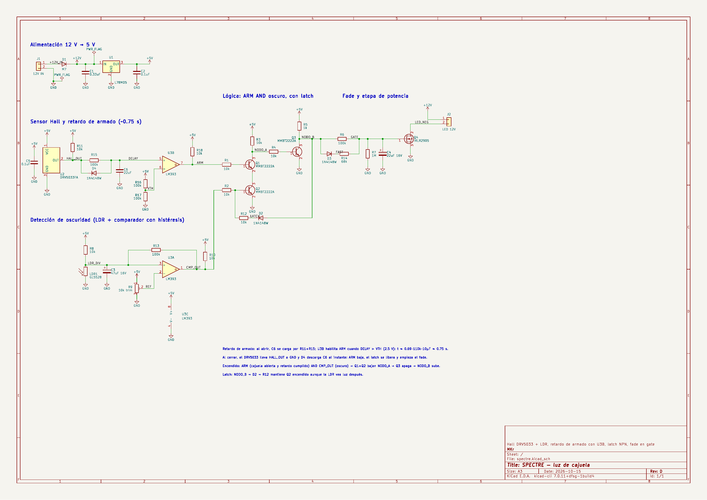

# SPECTRE

Luz LED para la cajuela de un auto que se enciende sola al abrirla, y solo cuando está oscuro.

Un sensor Hall detecta la apertura (un imán en la carrocería se aleja del sensor) y una fotorresistencia (LDR) decide si hay poca luz. Si las dos condiciones se cumplen, un MOSFET enciende la tira LED de 12 V con un encendido y apagado suave (fade). Funciona con lógica discreta: comparador LM393, transistores NPN y un MOSFET de nivel lógico. No lleva microcontrolador ni PWM.



## Diseños

El mismo circuito (rev D) está en dos versiones de placa, cada una en su carpeta y con su propia etiqueta:

| Carpeta | Versión | Placa | Sensores | Etiqueta |
|---|---|---|---|---|
| [`smt/`](smt/) | rev D | 42 x 32 mm, SMT, ensamblada de fábrica | DRV5033 y LDR soldados en la placa | `smt-rev-d` |
| [`tht/`](tht/) | rev D | 46 x 40 mm, THT, para soldar a mano | Hall y LDR por cable (J3, J4) | `tht-rev-d` |

Las dos son de 2 capas, sin barrenos de montaje y con una franja libre de 1 mm en todo el contorno para los rieles de la caja. Ambas usan conectores JST VH (B2P-VH, carcasa VHR-2N) para los 12 V y la tira LED. El historial de versiones está en [`CHANGELOG.md`](CHANGELOG.md).

```
docs/   esquemático (PDF/PNG) y logo
smt/    proyecto KiCad 7 completo, Gerbers, BOM y CPL para ensamble, vistas
tht/    PCB KiCad 7, Gerbers, lista de componentes, mapa de ensamble
```

## Cómo funciona

| Bloque | Piezas | Qué hace |
|---|---|---|
| Entrada | J1, D1, C1, U1, C2 | D1 protege contra polaridad invertida. U1 (78M05 / 7805) da 5 V a la lógica; los LED usan los +12 V. |
| Apertura | U2 (DRV5033), R11, C5 | Con la cajuela cerrada el imán está frente a U2 y su salida (HALL_OUT) está en bajo. Al abrir, R11 la sube a 5 V. |
| Retardo de armado | R15, C6, D4, R16, R17, U3B, R18 | HALL_OUT carga C6 por R11 + R15. Cuando DELAY pasa de VTH (2.5 V), U3B libera ARM. Son unos 1.5 s, el tiempo que necesita la LDR para leer la luz real. D4 descarga C6 de inmediato al cerrar. |
| Oscuridad | LDR1, R8, C3, R9, U3A, R10, R13 | U3A compara el divisor de la LDR con la referencia del trimpot R9. R13 da histéresis y C3 filtra parpadeos. CMP_OUT sube cuando está oscuro. |
| Compuerta Y | Q1, Q2, R1, R2, R3 | Q1 (armado) y Q2 (oscuridad) van en serie: NODO_A solo baja si ambos conducen. |
| Latch | D2, R12 | Una vez encendida, NODO_B mantiene la base de Q2 alta. Así la luz de la propia tira no apaga la lógica de oscuridad. |
| Driver y fade | Q3, R4, R5, R6, R14, D3, R7, C4, Q4 | Q3 invierte NODO_A. El gate de Q4 carga rápido por D3 + R14 (fade de encendido) y descarga lento por R6 (fade de apagado). R7 fija el voltaje final del gate. |
| Salida | Q4, J2 | El MOSFET conmuta el negativo de la tira LED (LED_NEG). |

### Conexiones (rev D, versión SMT)

| Red | Pines |
|---|---|
| `+12V_IN` | D1.2, J1.1 |
| `+12V` | C1.1, D1.1, J2.1, U1.1 |
| `+5V` | C2.1, C5.1, R3.1, R5.1, R8.1, R9.1, R10.1, R11.1, R16.1, R18.1, U1.3, U2.1, U3.8 |
| `GND` | C1.2, C2.2, C3.2, C4.2, C5.2, C6.2, J1.2, LDR1.2, Q2.2, Q3.2, Q4.3, R7.2, R9.3, R17.2, U1.2, U2.3, U3.4 |
| `HALL_OUT` | D4.1, R11.2, R15.1, U2.2 |
| `DELAY` | C6.1, D4.2, R15.2, U3.5 |
| `VTH` | R16.2, R17.1, U3.6 |
| `ARM` | R1.1, R18.2, U3.7 |
| `LDR_DIV` | C3.1, LDR1.1, R8.2, R13.2, U3.3 |
| `REF` | R9.2, U3.2 |
| `CMP_OUT` | R2.1, R10.2, R13.1, U3.1 |
| `Net-(Q1-B)` | Q1.1, R1.2 |
| `Net-(Q2-B)` | Q2.1, R2.2, R12.2 |
| `LATCH` | D2.1, R12.1 |
| `Net-(Q1-E)` | Q1.2, Q2.3 |
| `NODO_A` | Q1.3, R3.2, R4.1 |
| `Net-(Q3-B)` | Q3.1, R4.2 |
| `NODO_B` | D2.2, D3.2, Q3.3, R5.2, R6.1 |
| `FAST` | D3.1, R14.1 |
| `GATE` | C4.1, Q4.1, R6.2, R7.1, R14.2 |
| `LED_NEG` | J2.2, Q4.2 |
En la versión THT, U2 se sustituye por J3 (1 = +5V, 2 = GND, 3 = HALL_OUT) y LDR1 por J4 (1 = LDR_DIV, 2 = GND). Q1–Q3 son TO-92 con orden E-B-C, así que su numeración de pines cambia; las redes son las mismas.

### Conectores
- **J1:** 1 = +12 V del auto (con fusible de 2 A), 2 = GND.
- **J2:** 1 = LED+ (+12 V), 2 = LED−.
- El pin 1 es el pad cuadrado.

## Lista de materiales

- **SMT:** [`smt/fab/spectre-BOM.csv`](smt/fab/spectre-BOM.csv) (con números de parte) y [`smt/fab/spectre-CPL.csv`](smt/fab/spectre-CPL.csv) para el ensamble.
- **THT:** tabla completa en [`tht/README.md`](tht/README.md#lista-de-componentes).

| Función | SMT | THT |
|---|---|---|
| Regulador | L78M05 (DPAK) | LM7805 (TO-220) |
| MOSFET | IRLR2905 (DPAK) | IRLZ44N (TO-220) |
| Comparador | LM393 (SOIC-8) | LM393 (DIP-8) |
| NPN x3 | MMBT2222A (SOT-23) | 2N2222A / PN2222A (TO-92) |
| Diodo de entrada | M7 (SMA) | 1N4007 |
| Diodos de señal x3 | 1N4148W (SOD-123) | 1N4148 |
| Hall | DRV5033FAQDBZR en placa | DRV5033 (TO-92) o A3144, por cable |
| LDR | GL5528 en placa | GL5528 por cable |
| C3 / C4 | Panasonic EEE-1CA470WR / EEE-1CA220WR | Electrolíticos radiales 5 mm |
| C6 (retardo) | 22 µF 0805 X5R | 22 µF electrolítico |
| Resistencias | 0603 1 % | 1/4 W, montaje vertical |
| Trimpot R9 | Bourns 3314J 10 kΩ | Bourns 3296W 10 kΩ |

## Decisiones de diseño

- **Lógica discreta en vez de microcontrolador.** Son dos NPN como compuerta Y, sin firmware, y cada etapa se puede medir con multímetro.
- **Fade con RC en el gate, sin PWM.** C4 22 µF con R14 68 kΩ y D3 para el encendido, y R6 100 kΩ para el apagado. R14 era de 10 kΩ hasta la versión THT rev C.
- **Histéresis y filtro en la LDR.** R13 y C3 evitan que la luz parpadee en el umbral.
- **Latch.** Sin él, la luz de la propia tira LED haría que la LDR apagara el circuito.
- **Retardo de armado (rev D).** Al abrir de día, la LDR todavía venía de la cajuela cerrada y leía "oscuro"; el Hall armaba al instante y el latch dejaba la luz encendida. El RC más U3B (la mitad libre del LM393) retrasa el armado unos 1.5 s. C6 subió de 10 µF a 22 µF tras probarlo en protoboard.
- **DRV5033 en vez de A3144.** Es omnipolar (funciona con cualquier polo del imán) y más sensible, así que basta un imán pequeño.
- **JST VH.** Conector con seguro y apto para la corriente de la tira. Además J1 y J2 usan la misma carcasa VHR-2N.
- **Montaje por rieles.** Sin barrenos y con 1 mm libre de cobre y componentes en todo el borde, para que la caja impresa en 3D sostenga la placa por los costados.
- **Placa.** 2 capas con plano de GND en ambas caras. Pistas de potencia de 1.2 mm, de señal de 0.4 mm. DRC sin errores y netlist verificada pin por pin contra el esquemático.
- **Corriente.** D1 (1 A) limita la corriente total. Para tiras de más de ~0.8 A conviene un diodo de 2–3 A.

## Ajuste
De noche, con la cajuela abierta, tapa la LDR y gira R9 hasta que encienda. Para repetir la prueba, acerca y aleja el imán y espera unos 2 s, porque el latch mantiene la luz encendida.

## Licencia
MIT, ver [`LICENSE`](LICENSE).
