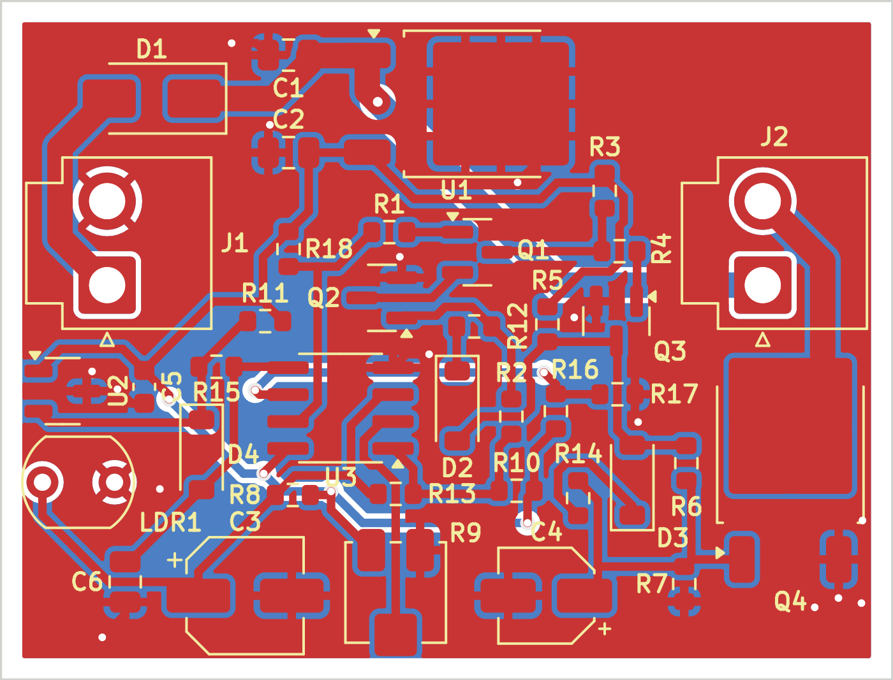

# SPECTRE SMT — rev D (42 x 32 mm, ensamblada de fábrica)

## Qué cambia respecto a la versión ensamblada anterior
Rev D agrega un **retardo de armado** para corregir una carrera encontrada en las pruebas. Antes, al abrir la cajuela de día, el Hall armaba al instante mientras la LDR, que venía de la cajuela cerrada, todavía leía "oscuro". En ese instante encendía el LED y el latch lo dejaba encendido.

Ahora el Hall ya no habilita a Q1 directamente. Pasa por un RC y por la segunda mitad del LM393 (U3B), que ya estaba en la placa sin usar.

| Ref | Valor | Función |
|---|---|---|
| R15 | 100 kΩ | HALL_OUT → DELAY (carga lenta) |
| C6 | 22 µF X5R 0805, 16 V o más | DELAY → GND |
| D4 | 1N4148W | Descarga rápida de C6 al cerrar (ánodo en DELAY, cátodo en HALL_OUT) |
| R16, R17 | 100 kΩ + 100 kΩ | Divisor de +5 V: VTH ≈ 2.5 V |
| U3B | LM393 pines 5, 6, 7 | Compara DELAY (5) contra VTH (6). Su salida (7) es ARM |
| R18 | 10 kΩ | Pull-up de ARM a +5 V |
| R1 | 10 kΩ (sin cambio) | Ahora va de ARM a la base de Q1, en vez de HALL_OUT |

Funcionamiento:
- **Al abrir:** HALL_OUT sube y C6 se carga por R11 + R15 (110 kΩ). A los **≈ 1.4–1.6 s** DELAY cruza los 2.5 V, ARM sube y Q1 queda habilitado. Para entonces la LDR (con su filtro C3) ya leyó la luz real.
  - De noche enciende con ese pequeño "despertar".
  - De día ya no se queda encendida.
- **Al cerrar:** D4 descarga C6 de inmediato, así que una reapertura rápida vuelve a tener retardo.
- **Ajuste del retardo:** C6 pasó de 10 µF (≈ 0.6–0.75 s) a 22 µF porque en la prueba en la THT el armado todavía le ganaba a la apertura. Los cerámicos pierden algo de capacidad con el voltaje, por eso doy rangos.
- **Puntos de medición:**
  - VTH (unión R16–R17 / U3 pin 6) ≈ 2.5 V.
  - DELAY (C6 / U3 pin 5): cerca de 0 V con la cajuela cerrada; sube en ~2 s al abrir.
  - ARM (R18 / U3 pin 7): 0 V cerrada, ~5 V al armar.

El resto del circuito no cambia: R14 68 kΩ, DRV5033 y LDR en placa, J1/J2 JST VH, latch y fade.

## Placa
- **Medidas:** 42 x 32 mm, 2 capas, FR-4 1.6 mm, cobre 1 oz. **Sin barrenos de montaje.**
- **Franja libre de 1 mm en todo el contorno para los rieles de la caja:**
  - No hay cobre a menos de 1.0 mm del borde (planos y pistas).
  - Ningún cuerpo de componente está a menos de 1.0 mm. La LDR1 queda a 1.02 mm.
  - Las referencias de serigrafía quedan fuera de la franja.
- **Posiciones de interfaz conservadas:** J1, J2, U2 (Hall), LDR1 y R9 (trimpot). Para despejar la franja hubo tres ajustes menores respecto a la ensamblada anterior:
  - J2, 0.4 mm a la izquierda.
  - U2, 0.3 mm hacia adentro.
  - R9, 0.5 mm hacia arriba.
- **Ruteo y planos:**
  - Pistas de señal de 0.4 mm. Las de potencia (+12V_IN, +12V, LED_NEG) son de 1.2 mm.
  - GND va por planos en ambas caras.
  - 22 vías, todas tapadas con máscara. Hay vías extra junto al source de Q4.
- **Serigrafía:**
  - Cada referencia queda junto a su pieza, legible después del ensamble.
  - Logo MKr SPECTRE en la cara inferior, 34.4 x 5.5 mm, en una zona sin pistas ni vías.
- **Verificación:**
  - DRC: 0 errores, 0 conexiones pendientes, huellas iguales a la librería (`fab/drc.rpt`).
  - Comparada pin por pin contra el esquemático aprobado: 38 componentes, 89 pads, 21 redes, 0 diferencias.
  - Cada huella está enlazada a su símbolo.

## Archivos
- `fab/spectre-gerbers.zip`: Gerbers (con pasta) y taladros.
- `fab/spectre-BOM.csv` / `fab/spectre-CPL.csv`: incluyen las piezas THT (J1, J2, LDR1) para que la fábrica también las monte.
- `spectre.kicad_pro` + `spectre.kicad_sch` + `spectre.kicad_pcb`: proyecto KiCad 7 completo (esquemático y PCB del mismo proyecto).
- `../docs/spectre-esquematico.pdf` / `../docs/esquematico.png`: el esquemático.
- `img/mapa-ensamble.png`: dónde va cada pieza. En rojo, las nuevas del retardo.
- `img/vista-superior.png`, `img/vista-inferior-logo.png`, `fab/drc.rpt`.
- `../docs/logo-MKr-SPECTRE.svg`: el logo vectorial.

## Conectores (VHR-2N del lado del cable)
- J1: 1 = +12V del auto, 2 = GND.
- J2: 1 = LED+ (+12V), 2 = LED−.
- El pin 1 es el pad cuadrado (triángulo en la serigrafía). J1 y J2 son idénticos: marca los cables.

## Instalación
- U2 detecta el campo perpendicular a la cara superior. El imán debe quedar frente a U2 (borde izquierdo) con la cajuela cerrada; cualquier polo funciona.
- LDR1 debe ver la luz ambiente; no la tapes con el arnés ni la pongas de frente a la tira LED.
- Ajuste de R9: de noche, cajuela abierta, tapa la LDR y gira hasta que encienda. Para repetir la prueba, acerca y aleja el imán y espera ~2 s.

## Prueba del retardo como mod en la THT rev C
En la THT rev C, U3 tiene el pin 5 a GND, el pin 6 a +5V y el pin 7 libre. Para el mod:
1. **Libera los pines 5 y 6 de U3.**
   - Si U3 está en zócalo, dobla esas dos patas hacia afuera para que no entren.
   - Si está soldado, corta las pistas que llegan a esos dos pads.
2. **Levanta la pata de R1 que va a HALL_OUT.**
3. **Conecta las piezas nuevas:**
   - R15 100 kΩ de HALL_OUT a U3-5.
   - C6 22 µF de U3-5 a GND (si es electrolítico, + a U3-5).
   - D4 1N4148: ánodo a U3-5, banda a HALL_OUT.
   - R16 100 kΩ de +5V a U3-6, y R17 100 kΩ de U3-6 a GND.
   - R18 10 kΩ de +5V a U3-7.
   - La pata levantada de R1, a U3-7.
4. **Qué esperar:** al abrir de día ya no enciende; de noche enciende ≈ 1.5 s después de abrir. Usa las mediciones de arriba para revisar.

## Antes de aprobar el ensamble
- En el CPL, J1, J2 y LDR1 usan el pin 1 como origen. La fábrica suele reubicar las THT en su vista previa: revisa que queden centradas.
- Revisa la rotación de SOT-23 (Q1–Q3, U2), SOD-123 (D2–D4), SMA, DPAK y electrolíticos.
- Los números de parte de resistencias y cerámicos son "o equivalente"; puedes aceptar la sustitución básica de la fábrica. Para C6 pide X5R/X7R de 16 V o más.
