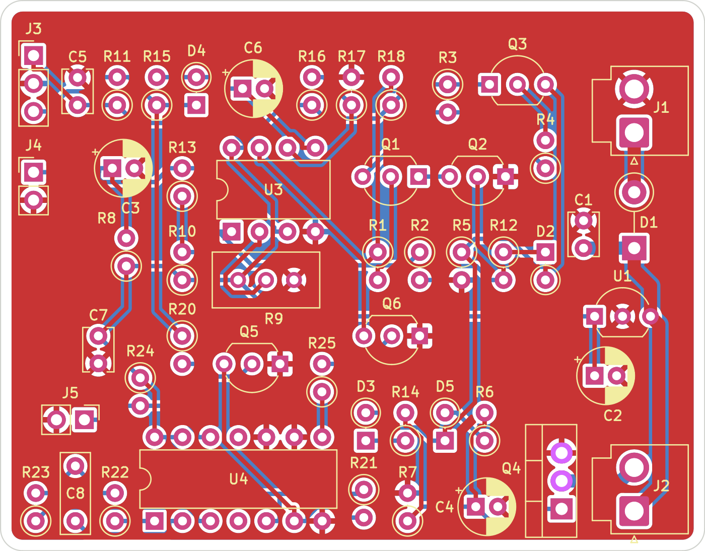

# SPECTRE THT — rev E (64 x 50 mm)

Mismo concepto que la rev D (Hall + LDR, retardo de armado, latch y fade), con tres cambios:

- **Apagado automático:** un CD4541 apaga la tira unos 10 minutos después de abrir la cajuela.
- **Fade simétrico:** el encendido y el apagado tienen cada uno su propio camino RC.
- **Menor consumo en reposo:** pasa de unos 14 mA a unos 5 mA.

Esta es la primera versión THT con esquemático propio: `spectre-tht.kicad_sch`.

## Cambios contra la rev D
| Bloque | rev D | rev E | Por qué |
|---|---|---|---|
| Apagado | — | U4 CD4541, Q5, Q6, R20–R25, C7, C8, J5 | Se apaga sola aunque la cajuela se quede abierta |
| Regulador | LM7805 (TO-220) | U1 LP2950-5.0 (TO-92) + C2 10 µF | Iq de 75 µA en vez de unos 5 mA |
| Inversor | Q3 NPN + R5 1 kΩ a +5 V | Q3 PNP 2N3906 + R5 4.7 kΩ a GND | No gasta corriente con la luz apagada (antes, unos 5 mA) |
| Fade | R6 100 kΩ en paralelo con D3 + R14 | D3 + R14 68 kΩ (encendido), D5 + R6 39 kΩ (apagado) | τ de encendido ≈ 1.5 s y τ de apagado ≈ 1 s, cada uno ajustable por separado |

## Cómo funciona el apagado
1. **Cajuela cerrada:** HALL_OUT está en bajo. Q5 no conduce, R21 pone MR (pin 6) en alto y el CD4541 queda en reset, con el oscilador detenido.
2. **Al abrir:** HALL_OUT sube, Q5 baja MR y el contador arranca. Unos 1.5 s después U3B libera ARM, igual que en la rev D.
3. **Al terminar el conteo:** después de 2^15 ciclos, TOUT (pin 8) sube y se queda así (modo de ciclo único). Q6 lleva ARM a GND, Q1 se corta y la tira se apaga con su fade. Con eso también se suelta el latch.
4. **Al cerrar:** MR vuelve a alto y el contador se reinicia. La siguiente apertura da otros 10 minutos completos.

**Configuración fija de U4:**

| Pin | Señal | Nivel | Efecto |
|---|---|---|---|
| 5 | AR | 1 | Sin auto-reset |
| 10 | MODE | 0 | Ciclo único |
| 9 | Q/Q̄ | 0 | Salida baja en reset |
| 13 | B | 1 | — |
| 12 | A | 1 (por R24) | 16 etapas |

**Tiempo:** T ≈ 2^15 · 2.3 · R22 · C8 = 32768 · 2.3 · 82 kΩ · 100 nF ≈ 618 s.

A 53 Hz el oscilador queda por debajo del rango en el que la hoja de datos garantiza la fórmula (1–100 kHz). Por eso conviene medir el tiempo real (ver Ajuste).

## Placa
- **Medidas:** 64 x 50 mm, 2 capas, FR-4 1.6 mm, cobre 1 oz.
- **Contorno:** esquinas redondeadas (r = 2 mm), sin barrenos y con una franja libre de 1 mm en todo el borde.
- **Acomodo por bloques:**
  - Sensores a la izquierda (J3, J4).
  - Retardo de armado arriba.
  - Lógica al centro.
  - Temporizador abajo a la izquierda.
  - Fade abajo al centro.
  - Potencia a la derecha (J1, D1, U1, Q4, J2).
- **Pistas:**
  - +12 V, +12V_IN y LED− son de 1.2 mm.
  - Las de señal son de 0.4 mm.
  - GND va por planos en ambas caras.
  - No hay vías.
- **Verificación:**
  - DRC: 0 errores y 0 conexiones pendientes (`fab/drc.rpt`).
  - Netlist del esquemático contra PCB, pad por pad: 51 componentes, 31 redes, 0 diferencias.
- **Gerbers:** `fab/spectre-tht-gerbers.zip` incluye cobre, máscara, serigrafía, contorno, taladros (Excellon, 129 barrenos) y mapa de taladros. Es lo que se sube a la fábrica.

## Lista de componentes
| Ref | Valor | Tipo / encapsulado |
|---|---|---|
| R1, R2, R3, R4, R8, R10, R11, R12, R18, R25 | 10 kΩ (x10) | Resistencia 1/4 W, montaje vertical |
| R13, R15, R16, R17, R21, R24 | 100 kΩ (x6) | Resistencia 1/4 W, montaje vertical |
| R5 | 4.7 kΩ | Resistencia 1/4 W, montaje vertical |
| R6 | 39 kΩ | Resistencia 1/4 W, montaje vertical |
| R14 | 68 kΩ | Resistencia 1/4 W, montaje vertical |
| R7 | 1 MΩ | Resistencia 1/4 W, montaje vertical |
| R20 | 220 kΩ | Resistencia 1/4 W, montaje vertical |
| R22 | 82 kΩ | Resistencia 1/4 W 1 %, montaje vertical (Rtc) |
| R23 | 180 kΩ | Resistencia 1/4 W, montaje vertical (Rs ≈ 2·Rtc) |
| R9 | 10 kΩ | Trimpot multivuelta Bourns 3296W (vertical) |
| C1 | 0.33 µF 50 V | Cerámico, paso 2.5 mm |
| C5, C7 | 0.1 µF 50 V (x2) | Cerámico, paso 2.5 mm |
| C8 | 100 nF 63 V | Película MKS2/MKT, paso 5 mm (Ctc, no usar cerámico) |
| C2 | 10 µF 16 V | Electrolítico radial 5 mm, paso 2 mm |
| C3 | 47 µF 16 V | Electrolítico radial 5 mm, paso 2 mm |
| C4, C6 | 22 µF 16 V (x2) | Electrolítico radial 5 mm, paso 2 mm |
| D1 | 1N4007 | Rectificador DO-41, vertical |
| D2, D3, D4, D5 | 1N4148 (x4) | Diodo de señal DO-35, vertical |
| Q1, Q2, Q5, Q6 | PN2222A / 2N2222A plástico (x4) | NPN TO-92 (E-B-C) |
| Q3 | 2N3906 | PNP TO-92 (E-B-C) |
| Q4 | IRLZ44N | MOSFET N nivel lógico TO-220 |
| U1 | LP2950-5.0 (LP2950CZ-5.0 / LP2950-50LP) | LDO 5 V TO-92 (OUT-GND-IN) |
| U3 | LM393 | Comparador dual DIP-8 (zócalo opcional) |
| U4 | CD4541BE (o MC14541B) | Temporizador programable DIP-14 (zócalo opcional) |
| J1, J2 | JST B2P-VH | Header VH 2 pines vertical; carcasa VHR-2N del lado del cable |
| J3 | Header 1x3, 2.54 mm | Cable al sensor Hall |
| J4 | Header 1x2, 2.54 mm | Cable a la LDR |
| J5 | Header 1x2, 2.54 mm + jumper | Modo de prueba del temporizador |

**Fuera de la placa:** sensor Hall DRV5033 (TO-92) o A3144 con imán, LDR GL5528, conectores Dupont y fusible de 2 A en la línea de 12 V.

## Conectores
- **J1:** 1 = +12 V del auto, 2 = GND.
- **J2:** 1 = LED+ (+12 V), 2 = LED−.
- **J3 (Hall):** 1 = +5 V, 2 = GND, 3 = salida del Hall.
- **J4 (LDR):** 1 = LDR_DIV, 2 = GND.
- **J5:** sin jumper = 10 min; con jumper = modo de prueba.

El pin 1 de cada conector es el pad cuadrado.

## Orientación al soldar
- **Electrolíticos (C2, C3, C4, C6):** la pata larga (+) va al pad marcado "+".
- **Diodos (D1–D5):** la banda del cátodo va al pad cuadrado.
- **Transistores TO-92 (Q1–Q3, Q5, Q6) y U1:**
  - El pad cuadrado es el pin 1: emisor en los transistores, OUT en U1.
  - La cara plana va según el dibujo de la serigrafía.
  - Ojo: Q3 es PNP.
- **Q4:** la pestaña metálica va hacia la franja angosta del rectángulo de serigrafía. G-D-S.
- **U3 y U4:** el pin 1 es el pad cuadrado, del lado de la muesca.

## Ajuste
- **R9:** se ajusta igual que en la rev D. De noche, con la cajuela abierta, tapa la LDR y gira hasta que encienda.
- **Tiempo de apagado:**
  1. Pon el jumper en J5 (A = 0, 2^9 ciclos) y abre la cajuela de noche.
  2. Mide cuánto tarda en apagarse; debería ser unos 10 s.
  3. Multiplica ese tiempo por 64 para obtener el tiempo real.
  4. Quita el jumper.
  5. Si quieres otro tiempo, cambia R22. El tiempo es proporcional a R22.
- **Puntos de medición:**
  - U4 pin 6 (MR): 5 V con la cajuela cerrada y 0 V abierta.
  - U4 pin 8 (TOUT): pasa a 5 V al cumplirse el tiempo.
  - U3 pin 7 (ARM): baja a 0 V en ese momento.

## Consumo en reposo (cajuela cerrada)
| Pieza | Consumo |
|---|---|
| Hall | ≈ 2.7 mA |
| R11, R18 y R9 | ≈ 0.5 mA cada una |
| LM393 | ≈ 0.4 mA |
| LP2950 | 75 µA |
| CD4541 en reset | µA |
| **Total** | **≈ 4.5–5 mA** (rev D: ≈ 14 mA) |

## Archivos
| Archivo | Contenido |
|---|---|
| `spectre-tht.kicad_pro` | Proyecto KiCad 7 |
| `spectre-tht.kicad_sch` | Esquemático |
| `spectre-tht.kicad_pcb` | PCB |
| `spectre-tht-esquematico.pdf` | Esquemático en PDF |
| `img/esquematico.png` | Esquemático en PNG |
| `img/vista-superior.png` | Vista de la cara de componentes |
| `img/vista-inferior.png` | Vista de la cara inferior |
| `img/mapa-ensamble.png` | Mapa de ensamble; en rojo lo nuevo y en ámbar lo que cambió |
| `fab/spectre-tht-gerbers.zip` | Gerbers y taladros para la fábrica |
| `fab/drc.rpt` | Reporte del DRC |
